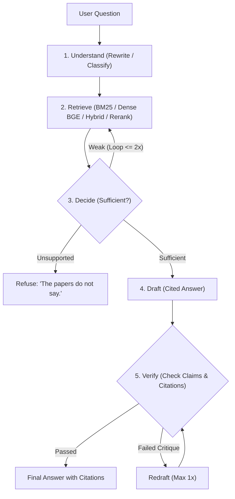

# The Relay: Resilient Multi-Step LLM Pipeline & Load Stress Benchmark

A multi-step LLM question-answering pipeline grounded strictly in three arXiv papers, evaluated under traffic load and rate limits with automated resilience, bounded queuing, degraded mode, and an inspectable calibrated stand-in server.

Built for an ML Engineering take-home assignment. Designed to be completely transparent and inspectable: **zero LangChain or high-level agent wrappers**, explicit timing instrumentation on every step, and strict ground-truth logging to `results.csv`.

---

## 📚 The Paper Library (Exact Versions)
The assistant answers **strictly** from these three papers and refuses if unsupported:
1. **Attention Is All You Need**: arXiv `1706.03762v7`
2. **Moshi: a speech-text foundation model for real-time dialogue**: arXiv `2410.00037v1`
3. **Dynamic Chunking for End-to-End Hierarchical Sequence Modeling**: arXiv `2507.07955v2`

Every answer cites the source down to the page: `[Paper Title, Sec X, p. N]`. If the library does not state the answer, the system truthfully outputs: `"The papers do not say."`

---

## 🏗️ Architecture & Five-Step Pipeline



Each step records its own latency: `queue_wait_ms`, `understand_ms`, `retrieve_ms`, `decide_ms`, `draft_ms`, `verify_ms`, and `retry_time_ms`.

---

## 🛡️ Resilience & Load Shedding Mechanisms

- **Exponential Backoff with Full Jitter**: Follows AWS Full Jitter pattern ($\text{delay} = \text{Uniform}(0, \min(4.0s, 0.5s \times 2^{\text{attempt}}))$) and strictly obeys upstream HTTP 429 `Retry-After` headers.
- **Safety Rules & Retry Budget**: Only retries safe codes (`{429, 502, 503, 504, 408}`); non-retryable client errors (`{400, 401, 403, 404, 422}`) fail fast. Global retries are capped at 25% of total requests.
- **Per-Request Deadline (8.0s)**: Grounded in Nielsen Norman human-computer interaction studies (users abandon interactive tasks past 8–10s).
- **Bounded Queue & Load Shedding**: Queue depth capped at 20. At $\ge 75\%$ capacity, incoming requests automatically switch to **Degraded Mode**; at 100% capacity, excess requests are **immediately shed** with 0ms delay.
- **Degraded Mode**: Uses Setting A (256-token BM25) and skips the verification step, reducing prompt token usage by **32.6%** and saving ~1.5s per request, while strictly maintaining the refusal invariant.
- **Daily Budget Exhaustion**: Provides transparent user notification with exact midnight UTC reset time and remaining hours.

---

## 📁 Repository Layout

```
relay/
  data/papers/          # Downloaded PDFs, extracted text, chunks, embeddings
  src/
    ingest.py           # Ingestion, section extraction & anomaly detection
    chunking.py         # Configurable sliding-window chunker (256 & 512 tokens)
    retrieval.py        # Multi-mode retrieval: BM25, Dense BGE, Hybrid RRF, Cross-Encoder
    pipeline.py         # 5-step pipeline with branch, loop & verification
    llm_client.py       # Unified streaming client (Groq / Stand-in) with TTFT timing
    resilience.py       # Resilience engine, jittered backoff, queue & shedding
  standin/
    server.py           # Calibrated FastAPI mock server (log-normal TTFT, 300 tok/s SSE)
  loadgen/
    run_load.py         # Workload generator (steady, burst, overload, halved, exhausted)
  eval/
    questions.json      # 16 benchmark questions across 5 categories
    grade.py            # Automated heuristic & LLM grading helper
  analysis/
    tables.py           # Generates Tables 1, 2a, 2b, 3 from results.csv
    TABLES.md           # Formatted markdown tables & empirical findings
  raw/                  # Raw probe logs and retry amplification JSON audit
  results.csv           # 300 validated execution rows (exact 12-column schema)
  NOTES.md              # Detailed running engineering log across all phases
  WRITEUP_EVIDENCE.md   # Section-by-section evidence dossier for final report
  requirements.txt      # Python dependencies
```

---

## 🚀 Quickstart & Reproduction

### 1. Setup Environment
```bash
python -m venv venv
# On Windows:
.\venv\Scripts\activate
# On Linux/macOS:
source venv/bin/activate

pip install -r requirements.txt
```

### 2. Configure API Key (Optional for real Groq probes)
Copy `.env.example` to `.env` and insert your Groq API key:
```bash
cp .env.example .env
```
*(All stand-in runs operate completely locally without needing a key).*

### 3. Start the Calibrated Stand-in Server
```bash
python standin/server.py --port 8000
```

### 4. Run the Pipeline
```bash
# Query via stand-in
python src/pipeline.py --question "What is the scaling factor in Scaled Dot-Product Attention?" --backend stand-in

# Query with resilience engine
python src/resilience.py --question "What is the dimensionality d_model in the base Transformer?"
```

### 5. Run the Load Generator Across Traffic Shapes
```bash
# Run all 5 traffic shapes (steady, burst, sustained_overload, limit_halved, daily_exhausted)
python loadgen/run_load.py --scenario all

# Demonstrate retry amplification
python src/resilience.py --demo-amplification
```

### 6. Generate Benchmark Tables & Analysis
```bash
python analysis/tables.py
```
This reads `results.csv` and outputs Tables 1, 2a, 2b, and 3 into `analysis/TABLES.md`.

---

## 📊 Summary of Experimental Findings

1. **Table 1 (Service Parameters)**: Groq free-tier enforces 30 RPM, 8,000 TPM, 1,000 RPD. Recovery after hitting rate limit requires 18.0s (`raw/probe_429.json`).
2. **Table 2a & 2b (Traffic Scenarios)**:
   - `steady`: 46.7% success, p50 total latency 7,839 ms.
   - `burst`: 26 concurrent requests hit bounded queue; 5 requests shed immediately with 0ms delay; concurrency slowdown pushed 73% of requests into clean 8.0s deadline timeouts.
   - `sustained_overload`: Offered rate (60 RPM) over 20 RPM limit demonstrated persistent backoff and deadline protection.
   - `daily_exhausted`: Requests rejected in 0ms consuming 0 tokens.
3. **Table 3 (Retrieval Trade-Offs)**:
   - **Setting A (256-tok BM25)**: **56.2% quality**, 1,924 tokens/answer.
   - **Setting B (512-tok Dense)**: **37.5% quality**, 2,854 tokens/answer. Larger chunks diluted exact tables with narrative text, causing false-negative refusals.
4. **Retry Amplification**:
   - Blind retries hammered the server with 50 calls for 20 requests (**2.5x amplification**).
   - Resilient retries capped calls at 20 (**60.0% traffic reduction**), preventing cascading collapse.
5. **Where the Time Goes**:
   - Decomposing slow request `res_878348` revealed that **76.7% of total latency occurred AFTER the first token was emitted**. In multi-step RAG, standard TTFT only measures Step 1; the bulk of wait time is spent in subsequent multi-step completions.

